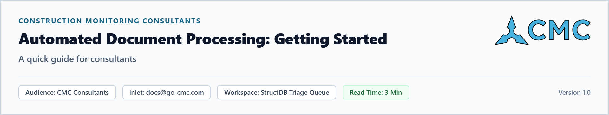
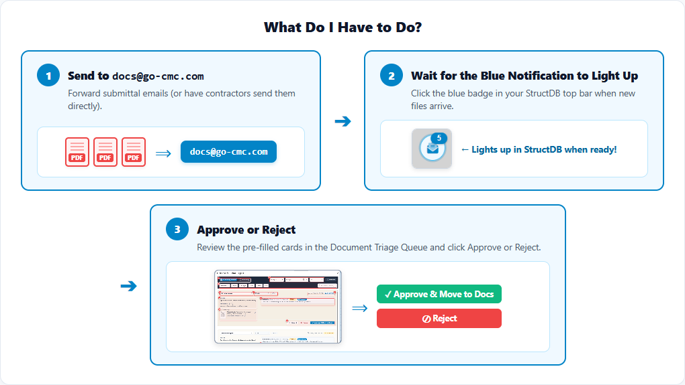
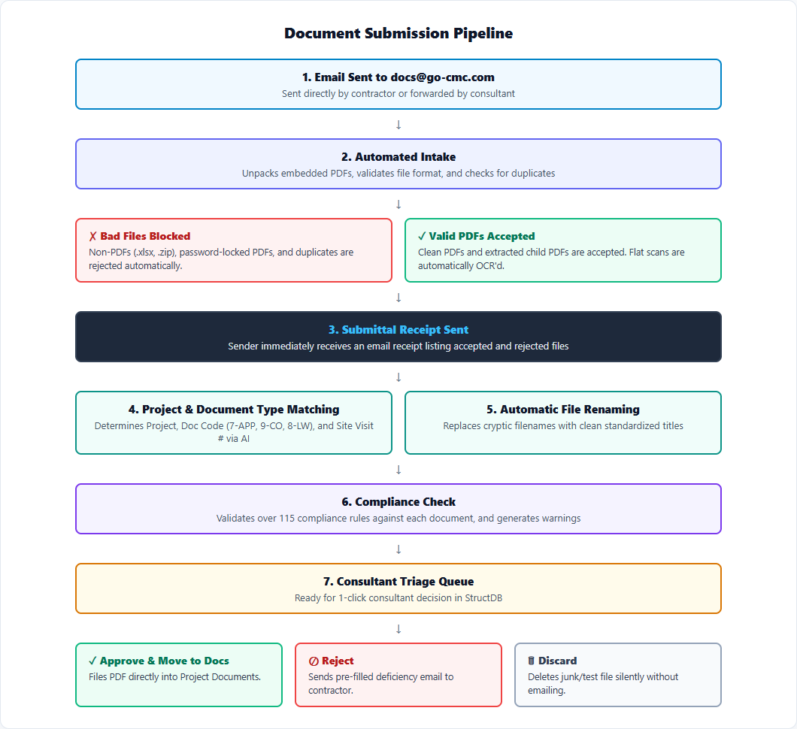
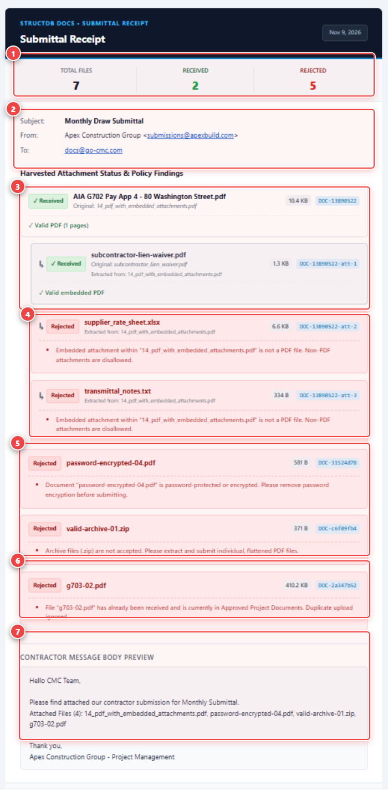
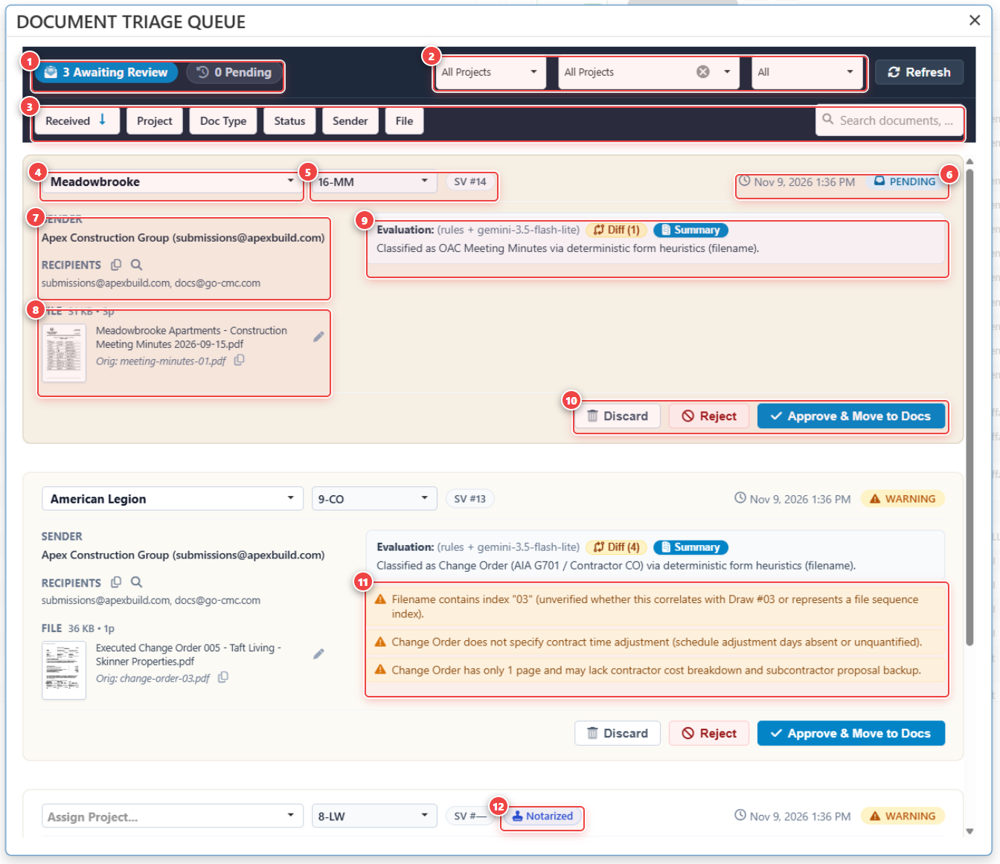
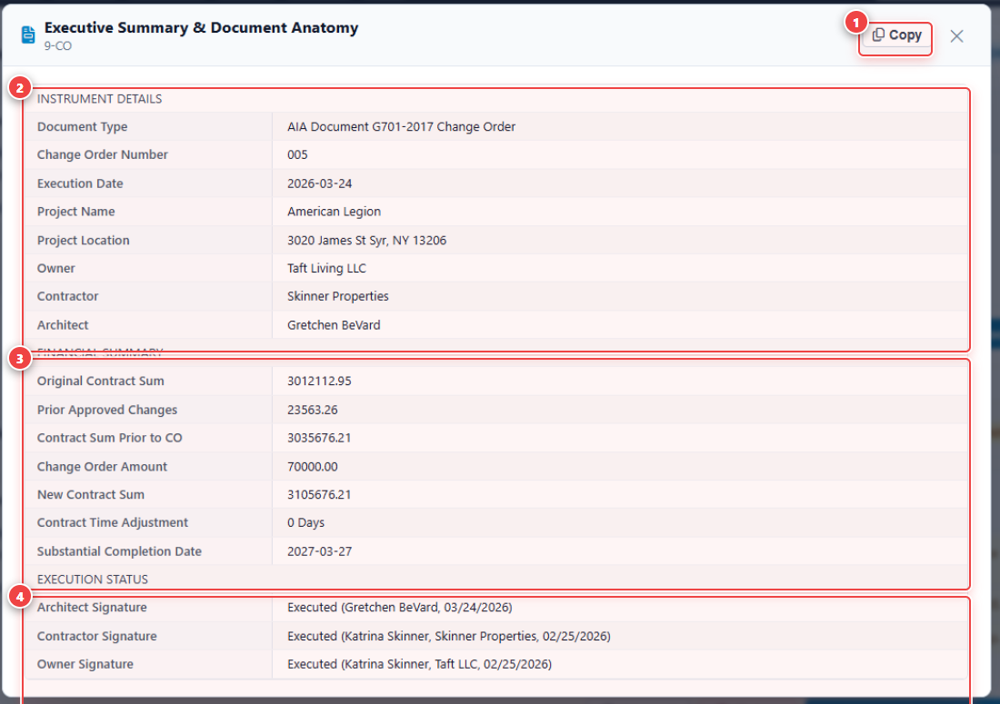
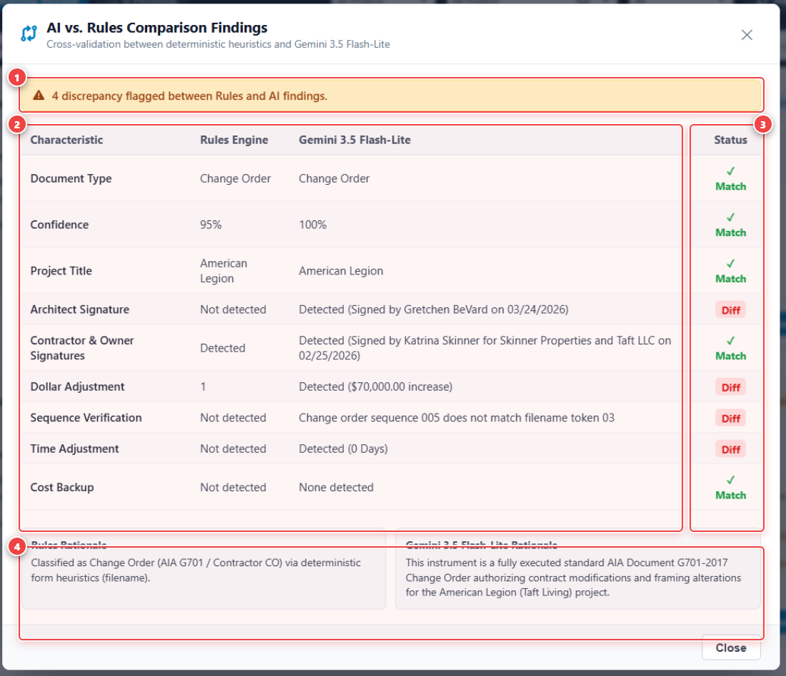

## Introduction

This document is a quick-start guide for using the new **StructDB Document Processing Pipeline**. It gives you enough information to get started with the most common use cases and a basic overview of the pipeline. It does not cover a wide range of edge cases. For a complete understanding of the architecture, see the **Automated Document Submission Pipeline Specification**.

### What You Can Stop Doing:

<table>
  <thead>
    <tr>
      <th align="left">Manual Task</th>
      <th align="left">What You Can Stop Doing</th>
    </tr>
  </thead>
  <tbody>
    <tr>
      <td style={{ backgroundColor: "#fef2f2" }}><strong>Stop Downloading Files</strong></td>
      <td>• Saving email attachments to your desktop just to open and upload them into StructDB.</td>
    </tr>
    <tr>
      <td style={{ backgroundColor: "#fef2f2" }}><strong>Stop Manual OCR</strong></td>
      <td>• Running Foxit or Adobe OCR by hand on flat scanned image PDFs.</td>
    </tr>
    <tr>
      <td style={{ backgroundColor: "#fef2f2" }}><strong>Stop Manual Renaming</strong></td>
      <td>• Typing out standardized filenames by hand for every incoming PDF.</td>
    </tr>
    <tr>
      <td style={{ backgroundColor: "#fef2f2" }}><strong>Stop Hunting for Project Info</strong></td>
      <td>• Looking up project names, document codes, and site visit numbers manually.</td>
    </tr>
    <tr>
      <td style={{ backgroundColor: "#fef2f2" }}><strong>Stop Compliance Auditing</strong></td>
      <td>• Stop poring over documents to find compliance issues.</td>
    </tr>
    <tr>
      <td style={{ backgroundColor: "#fef2f2" }}><strong>Stop Manual Stakeholder Emails</strong></td>
      <td>• Manually notifying stakeholders of document issues, locked PDFs, or missing signatures.</td>
    </tr>
  </tbody>
</table>

### What You Get Automatically:

<table>
  <thead>
    <tr>
      <th align="left">Feature</th>
      <th align="left">What Happens Automatically</th>
    </tr>
  </thead>
  <tbody>
    <tr>
      <td style={{ backgroundColor: "#f0fdf4" }}><strong>Automated Intake</strong></td>
      <td>• Non-PDFs (<code>.xlsx</code>, <code>.zip</code>), locked PDFs, and duplicates are blocked at the door. • Child PDFs hidden inside parent PDFs are unpacked automatically. • Stakeholders are notified of accepted and rejected docs.</td>
    </tr>
    <tr>
      <td style={{ backgroundColor: "#f0fdf4" }}><strong>Automatic OCR</strong></td>
      <td>• Scanned image PDFs are converted into 100% searchable text in the background.</td>
    </tr>
    <tr>
      <td style={{ backgroundColor: "#f0fdf4" }}><strong>Project Identification and Document Classification</strong></td>
      <td>• Determines project, type, and other metadata via AI.</td>
    </tr>
    <tr>
      <td style={{ backgroundColor: "#f0fdf4" }}><strong>Automatic File Renaming</strong></td>
      <td>• Replaces cryptic contractor filenames with clean standardized titles. • Preserves the original filename for reference.</td>
    </tr>
    <tr>
      <td style={{ backgroundColor: "#f0fdf4" }}><strong>Compliance Checks</strong></td>
      <td>• Validates over 115 compliance rules against each document. • Generates clear warnings for missing signatures, notary seals, math errors, or missing backup.</td>
    </tr>
    <tr>
      <td style={{ backgroundColor: "#f0fdf4" }}><strong>One-Click Insert</strong></td>
      <td>• Approve clean files directly into StructDB Project Documents in one click. • Send a pre-filled deficiency email to the contractor when rejecting a document.</td>
    </tr>
  </tbody>
</table>

---

## 1. How the Pipeline Works

---

## 2. Automated Submittal Receipt (Sent on Arrival)

When an email hits `docs@go-cmc.com`, the system immediately sends this receipt so you never have to chase down bad file formats or duplicates:

* **`[1]` Scoreboard:** Total files inspected, accepted (`Received`), and blocked (`Rejected`). Only green `Received` files enter your Triage Queue.
* **`[2]` Email Header:** Original subject line and sender address.
* **`[3]` Accepted PDFs:** Valid PDFs—and any child PDFs unpacked from inside them (`↳ subcontractor-lien-waiver.pdf`).
* **`[4]` Blocked Non-PDFs:** Embedded Excel/text files rejected automatically.
* **`[5]` Blocked Locked / Zipped Files:** Password-encrypted PDFs and `.zip` archives rejected with instructions to resubmit.
* **`[6]` Blocked Duplicates:** Files already in StructDB are ignored automatically.
* **`[7]` Message Preview:** The sender's original email text.

---

## 3. The Document Triage Queue

Click the **Document Triage** icon in the top navigation bar of StructDB.

* **`[1]` Queue Tabs:** **Awaiting Review** (ready now) vs. **Pending** (large scans currently finishing OCR).
* **`[2]` & `[3]` Filters & Sort:** Filter by **My Projects** (`[2]`) or sort/search (`[3]`).
* **`[4]` Project Dropdown:** Auto-selected Project. Click to change if needed.
* **`[5]` Doc Code & Site Visit:** Auto-selected Doc Code (`16-MM`, `9-CO`, `8-LW`, `7-APP`) and Site Visit badge (`SV #14`).
* **`[6]` Status Badge:** **Blue (`PENDING`)** = clean. **Amber (`WARNING`)** = review yellow warning banners (`[11]`).
* **`[7]` Sender:** Sender and recipients (click the copy icon to copy emails).
* **`[8]` PDF Thumbnail & Filename:** **Click the thumbnail** to open the full PDF viewer. Click the filename to edit it.
* **`[9]` `Diff` & `Summary` Buttons:** Open the compliance checklist (`Diff`) or key extracted numbers/signers (`Summary`).
* **`[10]` Action Buttons:** **`Approve & Move to Docs`**, **`Reject`**, or **`Discard`**.
* **`[11]` & `[12]` Warnings & Original Filename:** Specific compliance warnings (`[11]`) and the original filename (`[12]`).

---

## 4. Common Use Cases

### Case 1: Clean Document — Approve in 5 Seconds
1. Confirm **Project** (`[4]`), **Doc Code** (`[5]`), and **Filename** (`[8]`). *(Click thumbnail `[8]` if you want to view the PDF).*
2. Click **`Approve & Move to Docs`** (`[10]`).
3. The card clears and the PDF is filed into the project's Documents tab.

---

### Case 2: Document Has Warnings (`WARNING`) — Check `Summary` or `Diff`
When a card shows yellow warning banners (`[11]`), click **`Summary`** or **`Diff`** (`[9]`) to inspect the details without reading the whole PDF:

* **`Summary` Popup:** Shows a 2-sentence overview (`[1]`), extracted dollar amounts (`[2]`), and who signed on what dates (`[3]`).

* **`Diff` Popup:** Compares every compliance check side-by-side (`[2]` & `[3]`)—such as Architect Signature, Contractor Signature, Dollar Adjustment, and Cost Backup.
* **Decision:** If acceptable, click **`Approve & Move to Docs`**. If the contractor needs to resubmit, click **`Reject`**.

---

### Case 3: Deficient Document — Reject & Notify Contractor
1. Click **`Reject`** (`[10]`).
2. The rejection popup opens with the sender's email and the specific warnings **already filled in**.
3. Edit the note if needed and click **Send**. The contractor receives a rejection notice and the card is removed from your queue. *(Use **`Discard`** if you want to delete a junk/test file silently without sending an email).*

---

### Case 4: Unidentified Project (`Assign Project...`)
If a contractor submits a blank template with no project name on it:
1. Click the **Thumbnail** (`[8]`) or check the **Sender** (`[7]`) to identify the project.
2. Select the project from the **`Assign Project...`** dropdown (`[4]`), then click **`Approve & Move to Docs`**.
